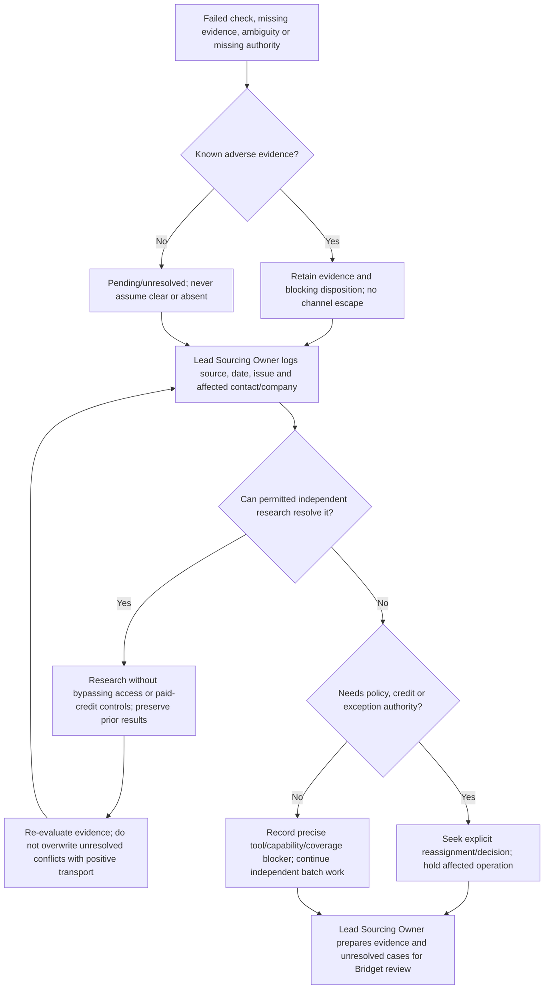

# Envision prospecting process map

This maps the maintained sourcing SOP; it is not a separate policy. Current human
roles are Lead Sourcing Owner (research and quality control) and Bridget (company
list and final approval). Roxy is a historical process author, not an active reviewer.
Codex assists with authorized research; it does not acquire historical approval
powers. This map describes the reusable workflow. Private batch workbooks, source lists and
research outcomes are stored outside the repository; they are not production fixtures.

Implementation detail: master intake/checkpoints, HubSpot matching, Dripify collection,
workbook updates and evidence-derived progress are implemented. Public-source collection,
Tavily and Apollo discovery adapters exist, but dependable contact discovery is not
operational: Apollo access is blocked and Tavily testing is paused. The human research
steps below remain necessary; no adapter success substitutes for their evidence.

Legend: **M** = human/manual SOP activity; **A** = implemented request helper;
**P** = offline prototype; **G** = capability/authority gap. Availability of a helper
is not verification of current provider access, schema or response completeness.

## End-to-end flow

```mermaid
flowchart TD
    A[Bridget supplies spreadsheet and sourcing batch is authorized] --> B[M: next 10 in exact original order; preserve names]
    B --> C[M: verify legitimacy, website, ownership, parent and employee domain]
    C --> D{Company evidence sufficient?}
    D -->|No| X[Keep original company; log unresolved; no substitute]
    D -->|Yes| E[M/G: HubSpot-first record, association, reply and suppression research]
    E --> F[M: public web and AI contact search; 3–5 qualified contacts]
    F --> G[M: personal LinkedIn identity and employment confirmation]
    G --> H{Current relevant person confirmed?}
    H -->|No| X
    H -->|Yes| I[M: Apollo same roles; reveal only after confirmation and authorized credits]
    I --> J[M: compare AI, public and Apollo evidence]
    J --> K[M: HubSpot email history; Apollo; public named-employee anchor; at least 10 searches before no-anchor conclusion]
    K --> L[A: approved Findymail discovery; compare sources; preserve pattern-inferred provenance]
    L --> EM{Individual email candidate found?}
    EM -->|No| T
    EM -->|Yes| M[A: authorized NeverBounce verification]
    M --> N{Provider result and identity evidence}
    N -->|Invalid| O[Block email eligibility; retain evidence]
    N -->|Unknown or catch-all| Q[A: authorized Findymail second check; unresolved risk stays pending]
    N -->|Failed, missing or conflicting| R[Pending; investigate without guessing]
    N -->|Valid| S{Usable verified email and no unresolved risk?}
    Q --> S
    O --> T[No usable email route; not automatic permission for LinkedIn]
    R --> T
    S -->|Yes| U[Email selected for review; skip Dripify lookup]
    U --> V[P/G: email cross-channel check stays pending]
    S -->|No| T
    T --> W[A/G: Dripify confirmed personal LinkedIn lookup first]
    W --> Y{Complete explicit match or no-match?}
    Y -->|Match| Z[Existing Dripify; do not duplicate]
    Y -->|Failure, ambiguity or incomplete pages| R2[Dripify pending; no absence inferred]
    Y -->|No match| AA{Known email available?}
    AA -->|Yes| AB[A/G: secondary email duplicate lookup]
    AA -->|No| AC[No-match review flag only]
    AB --> AD{Complete result?}
    AD -->|Match| Z
    AD -->|No match| AC
    AD -->|Unresolved| R2
    X --> AE[M: 14-column sheet plus separate evidence and unresolved log]
    V --> AE
    Z --> AE
    R2 --> AE
    AC --> AE
    AE --> AF[P: internal evidence intake and eligibility review; known suppression blocks, gaps pending]
    AF --> AG[M: Lead Sourcing Owner reviews batch; resolves or flags issues]
    AG --> AH{Ready for Bridget review?}
    AH -->|Needs research| AE
    AH -->|Ready with truthful dispositions| AI[M: Bridget approves, rejects or requests changes]
    AI -->|Changes requested| AE
    AI -->|Review complete| AJ[Stop: prospecting handoff; no sends, CRM writes, enrollment or meetings]
```

The diagram's Dripify branch never converts email suppression into permission for
LinkedIn. A known opt-out, historical hard bounce or active conflict stays blocking
under the existing evaluator. The SOP's `eligible for Dripify outreach` no-match
flag is a review flag, not overall clearance. It cannot override pending HubSpot,
subscription, identity, history or cross-channel evidence. Existing failed company
and person checks are delivered as exceptions, not fabricated contact rows.

## Step table

| Stage | Owner | Input | Activity / tool | Output | Decision rule |
| --- | --- | --- | --- | --- | --- |
| 1. Intake | Bridget; Lead Sourcing Owner coordinates | Bridget spreadsheet and explicit batch authorization | M: select next 10, preserve exact names/priorities | Batch positions and unchanged company identities | Missing spreadsheet/authorization: hold selection; no invented companies |
| 2. Company | Lead Sourcing Owner with Codex | Listed brand and supplied website | M: permitted public web research, registration evidence where relevant | Website, legitimacy, operator, employee domain, category, URLs/date | Unverified company: log, preserve row identity, never replace |
| 3. Existing records | Lead Sourcing Owner with verified access | Brand, website domain, known identifiers | M/G: HubSpot company/contact associations, prior replies and suppression checks | Existing/new disposition and history/coverage evidence | Read-only HubSpot client and batch matching are implemented and previously validated; incomplete suppression/history coverage stays pending |
| 4. Discovery | Lead Sourcing Owner with Codex | Verified company/routing and established role order | M: AI/public research, 3–5 current qualified contacts | Named candidates with personal LinkedIn and role sources | Senior marketing/brand heads/directors first; secondary social/influencer/community; honest shortfalls |
| 5. Employment | Lead Sourcing Owner with Codex | Candidate identity and role claims | M: personal LinkedIn plus public corroboration | Dated current role/company confirmation | LinkedIn primary for employment conflicts; ambiguity pending; departed-role case logged |
| 6. Apollo comparison | Lead Sourcing Owner with approved access | Confirmed person, same roles/exclusions | M: Apollo search and authorized reveal; compare AI/public sources | Sources agreeing/disagreeing and work-email candidate | No reveal before confirmation; no unauthorized paid operation |
| 7. Email discovery | Lead Sourcing Owner with Codex | HubSpot history, Apollo candidate, public employee anchor | M/A: public research, at least 10 anchor searches before not found, authorized Findymail find | Individual professional candidates, source/pattern and person linkage | No shared inbox; pattern is inferred; disagreement unresolved unless evidence resolves it |
| 8. Validation | Lead Sourcing Owner with Codex | Exact person/email evidence and credit authorization | A: NeverBounce; approved Findymail verifier where appropriate | Exact provider outcomes/date and unresolved flags | Invalid blocks email; unknown/catch-all/error holds; second check/anchor cannot waive risk; valid mailbox is not ownership proof |
| 9. Route/Dripify | Lead Sourcing Owner with Codex | Candidate plus verification/risk evidence | M/A/G: email-first selection or LinkedIn-first Dripify search then email secondary | Route, matches, lookup dates, pending/no-match review flags | Email-selected skips Dripify and stays cross-channel pending; explicit complete no-match required for absence |
| 10. Evidence review | Lead Sourcing Owner | Separate linked internal evidence | P: evidence.assemble()/evaluate_evidence(), eligibility.evaluate() | blocked / pending / eligible_for_review plus reasons | Unsupported schema, incomplete coverage, stale/missing evidence or failed lookup cannot clear; sending authorization false |
| 11. Output and QC | Lead Sourcing Owner | Research findings, evidence and batch summary | M: fixed 14-column sheet, five exact confidence labels; unresolved log | Review-ready batch, explicit exceptions, verified findings distinguished from holds | No invented quota completion; no schema changes or sheet edits to external list without authorization |
| 12. Final handoff | Bridget after Lead Sourcing Owner review | Completed batch and exception record | M: approve/reject/request changes | Final reviewed prospecting handoff | Approval is not sending, enrollment, CRM-write or policy-change authorization |

## Exception and escalation flow

Use the existing unresolved-log fields: Campaign, Batch, Company, Full Name, Role,
LinkedIn URL, Reason unresolved, Date, Case Type where applicable. Retain Identity
Ambiguous, Data Corruption, Departed-Role Changed and Other. Confirm its location
before external writes. Missing contacts are not filled with fabricated names;
company exceptions retain Bridget's name and batch position.

## Responsibility and approval matrix

| Responsibility | Performer | Review/approval | Limit |
| --- | --- | --- | --- |
| Supply/add/substitute target companies | Bridget | Bridget explicitly requests changes | Codex cannot discover/add targets independently |
| Company/contact/public-web research | Codex assists Lead Sourcing Owner | Lead Sourcing Owner quality review | Permitted public sources only; no access circumvention |
| Employment/person-address corroboration | Codex assists Lead Sourcing Owner | Lead Sourcing Owner | Verification transport or mailbox validity cannot establish identity |
| Provider discovery/verification | Available helpers under Lead Sourcing Owner direction | Confirmed applicable credit authority | No assumed transfer of historical paid-credit permissions |
| HubSpot/Dripify evidence | Authorized readers; Codex only through verified permitted capabilities | Lead Sourcing Owner | No guessed fields, absence or membership; no external writes |
| Batch QC and readiness for Bridget | Lead Sourcing Owner | Lead Sourcing Owner | Sole human research/QC owner; unresolved findings remain explicit |
| Final prospecting approval | Bridget | Bridget | Does not authorize sending or waive suppression |
| Paid credits, policy exceptions or storage decisions | Explicitly designated authority, not yet assumed | Reassignment must be confirmed | Lead Sourcing Owner may coordinate questions but not self-authorize inherited powers |
| Outreach/CRM execution | Outside this SOP | Separate team authority | No campaigns, sequences, follow-ups, sends, enrollment, bookings or CRM writes |

## Historical permissions requiring reassignment

- Roxy's approval for non-Apollo paid credits; also confirm any paid Apollo reveal
  authorization rather than treating its place in the process as a spending grant.
- Executive/founder exceptions beyond the established documented small-company rule.
- Email-selected cross-channel/Dripify policy changes and other eligibility policies.
- Review-label exceptions, conflicting confidence classifications and new process rules.
- Evidence/unresolved-log destination authorization, access and retention decisions.
- Historical HubSpot-write/campaign-association approval: unassigned and outside the
  current prospecting scope even after research is approved.

Lead Sourcing Owner is the current research/QC role, not a blanket replacement
approver for this register. Confirm each authority and scope explicitly.

## Implemented capabilities, gaps and decisions

- Implemented A: relay-only Findymail/NeverBounce and Dripify request helpers, with
  bearer authentication, fixed hosts, timeouts, redirect blocking and JSON output.
  No live request was made while preparing this map.
- A/P: the read-only HubSpot client, Dripify collector and batch integration are implemented.
  The shared per-person packet feeds employment assessment, eligibility, workbook evidence
  and progress counts. Complete provider-to-passing-evidence normalization remains unavailable;
  raw provider JSON, empty responses and successful transport never prove clearance.
- A/G: PR #7 read-only relay routes are merged at `412d160`, with deployment and
  bounded live retrieval previously confirmed. Resumable pagination and historical
  positive evidence are implemented; all-owner visibility, retention, freshness and
  complete account/history coverage remain unresolved.
- G: email-first SOP skips Dripify. The intake preserves an unresolved cross-channel
  flag. This handoff remains pending until authorized policy resolution, not cleared
  by the owner change or Bridget's review.
- P: the current approval contract requires `lead_sourcing_owner` review followed by
  `bridget` approval. Legacy `roxy` assertions are preserved as historical records
  and cannot satisfy active review or transfer spending/exception authority.
  Human batch review and technical eligibility remain distinct.
- G: verification freshness, recontact/cooldowns, subscription applicability,
  evidence storage, executive exceptions and approval scope need confirmed policy.
- Existing sheet keeps exactly the SOP's 14 columns and five confidence labels;
  web evidence, category, metrics and policy decisions stay in linked records.

## How to initiate an actual batch

Supply Bridget's spreadsheet and say: "Use Bridget's spreadsheet; research the
next 10 unprocessed companies in the original order under the current SOP. Keep
names and priorities unchanged. Do permitted public research and only provider
operations with explicit confirmed credit/access authorization. Return the fixed
review sheet, linked evidence, batch counts and unresolved log for my Lead Sourcing
Owner review, then Bridget's approval. No outreach or CRM writes."

Identify the approved progress record or batch starting position. If it is unknown,
ask before selecting companies to avoid duplicate batches; do not infer that a row
is already researched. Confirm the approver for any paid operation and the evidence
storage location separately. If a tool is unavailable, continue safe independent
research and report the specific blocker without claiming verification.

## Workbook enrichment and two-track execution
The SOP's Output workbook section is authoritative: Company Research, New Prospect
Contacts, Existing HubSpot Contacts, Verification Evidence, Unresolved Issues,
Batch Summary. Company Research has the specified 17 fields; contact review keeps
exactly 14 columns. Existing HubSpot Contacts includes personal LinkedIn and email,
actual confirmed contact identity/IDs and available history/suppression evidence.
Company-record links do not establish individual contact matches. Unresolved
HubSpot candidates remain in evidence, never falsely classified as new.

Track A continues permitted company/contact/public-email research in original row
order while Track B validates read-only capabilities. A working campaign-list call
is not enrollment/absence proof. Only explicitly authorized free/paid operations
may run; missing permissions and source coverage remain pending. No writes occur.

Use the SOP's exact 12 categories and independently apply its exact five follower
tiers to Instagram and Facebook. Preserve original category/price/count provenance;
flag out-of-taxonomy input for review. Blank count plus N/A means not verified,
not zero. Never confuse Facebook likes and followers or carry an old snapshot
forward as current. Counts, source URLs and dates live outside the fixed contact
sheet. All original approval and cross-channel holds remain in force.
